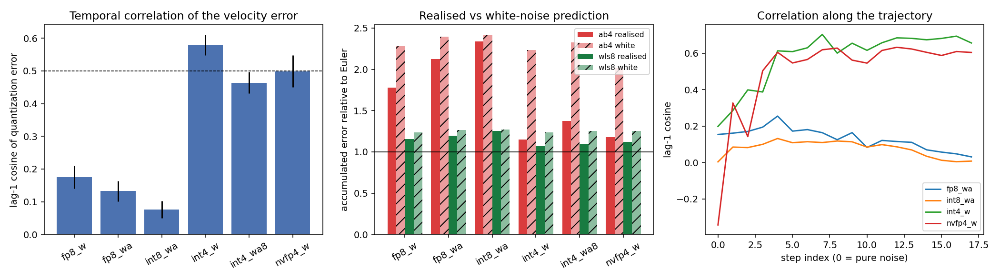
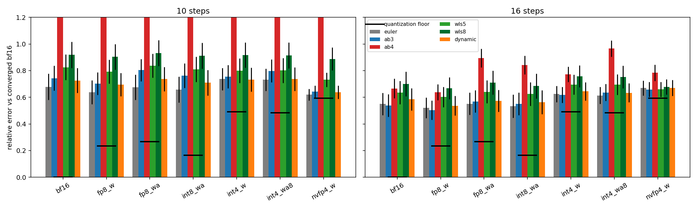
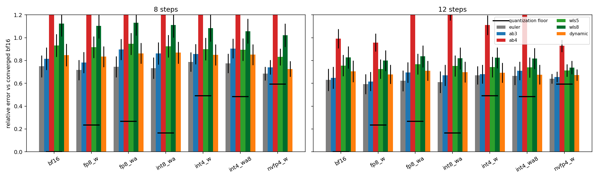

# Flow-WLS under Quantization: Does a Multistep Sampler Survive FP8 / INT4 Velocity Errors?

> **Status: protocol registered, experiments running.** This section was written on 2026-11-03
> *before* any real-model measurement. Results are appended below it as they come in and nothing
> above the line "Results" is edited afterwards except to fix typos.

Follow-up to [Flow-WLS](https://doi.org/10.5281/zenodo.23337579) (regularized multistep integration,
`flow_wls_L`, d = 2, memory decay gamma = 0.85) and to the earlier
[adaptive-step-samplers](https://github.com/YakovSava/adaptive-step-samplers) /
`flow-sde-research` work. Same conventions: no extra network evaluations, paired comparisons with
bootstrap intervals, negative results reported as such.

## Question

Quantizing weights and activations (FP8, INT8, INT4, NVFP4) perturbs the velocity field the sampler
integrates: `v_q(x, t) = v(x, t) + e(x, t)`. Two claims are common:

1. Multistep solvers are *especially* sensitive, because they reuse past (erroneous) evaluations.
2. A regularized multistep method such as Flow-WLS can damp the "high-frequency" quantization noise,
   and a *dynamic* regularization can do it better than a fixed one.

Both statements implicitly assume that `e` behaves like noise that is independent from step to step.
This work first **measures what `e` actually looks like along a sampling trajectory**, and only then
asks which sampler copes best.

## Methods (summary)

* `history_filter.py` - one family of explicit multistep rules, `x_{n+1} = x_n + sum_k w_k v_{n-k}`,
  where the weights come from a weighted least-squares polynomial fit of the velocity history
  (`FilterSpec(length, gamma, degree, ridge)`). Adams-Bashforth of order p is the special case
  `length = p, degree = p - 1, gamma = 1` (interpolation); Flow-WLS is `degree = 2, gamma = 0.85`;
  Euler is `length = 1`. All samplers share one code path (`samplers.sample_history`), so
  differences between them are differences of weights only.
* **Dynamic regularization (new).** At every step the sampler chooses `(length, gamma, degree)` from
  a fixed grid by rolling-origin validation: each candidate predicts the last three velocities from
  the history that precedes them, and the candidate with the smallest squared prediction error wins.
  Because the score is a quadratic form in the history, it needs only the Gram matrix of the last
  11 velocity fields (`HistoryGram`), i.e. a few inner products per step and **zero extra network
  evaluations**.
* `fakequant.py` - simulated quantization of the DiT block linears (`blocks.*`): FP8 E4M3 per tensor,
  INT8 per output channel / per token, INT4 with group 64, NVFP4 (E2M1, block 16, FP8 block scales);
  activations quantized dynamically on the input of every quantized linear. Embedders, the final
  layer, the text path and norms stay in bf16. This is *numerical simulation*, not a hardware kernel.
* Model: Anima (`anima_aestheticV11`, bf16, 576x768, CFG 5, 4 prompt classes x 3 seeds), the only
  checkpoint on this machine that is not already quantized.

## Pre-registered hypotheses

All are about the *relative* final-latent error `||x - x_ref|| / ||x_ref||`, where `x_ref` is the
unquantized model integrated with 40-60 steps; pairs are (prompt, seed).

| # | Hypothesis | Counts as supported if |
| --- | --- | --- |
| H1 | The quantization error `e_n = v_q(x_n) - v(x_n)` is **temporally correlated**, not white | median lag-1 cosine similarity of `e_n` along the trajectory > 0.5 for every format |
| H2 | Because of H1, the realised accumulation of `e` by a multistep rule is **close to the Euler value and far below** the white-noise prediction | realised/predicted ratio of the accumulated error < 0.7 for AB-4 |
| H3 | Aggressive formats (INT4, NVFP4, activation-quantized) hurt Adams-Bashforth-4 more than Euler and WLS-8 at 8-12 steps | extra error of AB-4 from quantization exceeds that of WLS-8, 95% bootstrap interval excludes 0 |
| H4 | WLS-8 has lower total error than AB-4 under every quantization format at 8 and 12 steps | interval of the paired difference excludes 0 in the WLS-8 favour in a majority of cells |
| H5 | The dynamic rule is **no better** than the best fixed WLS setting (expected null), but is never much worse | interval of (dynamic - best static) includes 0 or is positive in most cells; regret <= 10% |
| H6 | For INT4-class formats the quantization floor (error of the *converged* quantized model against the full-precision one) is larger than the discretization error of a 12-step sampler | floor / discretization error > 1 |

Prior expectation, written down before running: H1 and H2 probable, H3 half-true (only for
activation noise), H4 probable, H5 null.

Two controls precede the real-model runs: a synthetic flow with exactly known velocity (below) and
unit tests (`tests/`, 45 tests).

## Synthetic control (2-mode Gaussian mixture, D = 256, shift-3 schedule, 32 trials)

The exact flow-matching velocity of a Gaussian mixture is closed-form, so the integration error can be
separated from everything else. Three velocity-error models of the same relative size `level`:
`white` (fresh i.i.d. noise per evaluation), `smooth` (a fixed random linear map of `v`, a stand-in
for a weight perturbation) and `rounding` (rounding of `v` onto a coarse grid with fixed dithers).

Relative final error, selected cells (`results/synthetic.json` has all of them):

| error model | level | NFE | euler | ab3 | ab4 | wls5 | wls8 | dynamic |
| --- | --- | --- | --- | --- | --- | --- | --- | --- |
| none | 0 | 12 | 0.208 | 0.118 | **0.113** | 0.124 | 0.132 | 0.120 |
| white | 0.1 | 12 | 0.210 | 0.132 | 0.217 | **0.129** | 0.137 | 0.139 |
| white | 0.2 | 12 | 0.221 | 0.167 | 0.381 | **0.143** | 0.151 | 0.154 |
| white | 0.2 | 20 | 0.143 | 0.071 | 0.104 | 0.071 | **0.067** | **0.067** |
| smooth | 0.2 | 12 | 0.261 | 0.188 | **0.186** | 0.191 | 0.196 | 0.188 |
| rounding | 0.2 | 12 | 0.226 | 0.173 | 0.397 | **0.156** | 0.161 | 0.166 |

What this says (toy problem, not the real model):

* AB-4 is destroyed by white or rounding-like errors (error x3 at level 0.2) - the concern in the
  question is real for that kind of error.
* For the `smooth` (bias-like) error **no sampler helps**: ranking stays what it is without noise,
  AB-4 is even slightly best. A history filter cannot remove an error that is the same at every step.
* The dynamic rule tracks the better of "AB-like" and "WLS-like" but does not beat the best
  fixed choice. Its grid was chosen on this toy only (one of four candidate grids; a degree-1 option
  with ridge, which looked attractive for noise, was *worse* because it biases the integral) and
  frozen before the real-model runs.

So the decisive empirical question is which of the three error types quantization produces. That is
experiment E1.

## Experiments

* **E1 - structure of the quantization error.** Integrate the bf16 model for 20 steps, store `x_n`,
  then re-evaluate the *same* states with each quantized model. `e_n = v_q(x_n) - v(x_n)`. Report
  relative size, lag-1/2 cosine, second-difference ratio (1 for white, ~0 for smooth), spatial
  high-frequency share, and the *accumulated response*: the norm of `sum_j c_j e_j` (c = composite
  quadrature weights of the sampler) relative to Euler, against the white-noise prediction.
* **E2 - end-to-end.** Samplers `euler, ab3, ab4, wls5, wls8, dynamic` x budgets 8 and 12 x
  quantization formats x (prompt, seed) pairs; error against the bf16 reference and against the
  quantized model's own converged solution.

## Results

### E1 - structure of the quantization error (8 units: 4 prompts x 2 seeds, 20 steps)

Mean over units; "real/white" is the accumulated error of the sampler relative to Euler, measured on the
actual `e_n` (real) and predicted if the same `e_n` were independent between steps (white).
Statistics exclude the final evaluation (sigma ~ 0.01), whose relative error is 40-70% for every format
but which only feeds an Euler jump of size sigma.

| format | rel. size of `e` | lag-1 cos | lag-2 cos | ab4 real/white | wls5 real/white | wls8 real/white |
| --- | --- | --- | --- | --- | --- | --- |
| fp8_w (E4M3 weights) | 0.056 | 0.175 | 0.106 | 1.78 / 2.28 | 1.20 / 1.31 | 1.16 / 1.23 |
| fp8_wa (E4M3 W+A) | 0.100 | 0.132 | 0.083 | 2.12 / 2.39 | 1.30 / 1.38 | 1.20 / 1.27 |
| int8_wa (W per channel, A per token) | 0.082 | 0.076 | 0.040 | 2.34 / 2.42 | 1.37 / 1.39 | 1.25 / 1.27 |
| int4_w (group 64) | 0.156 | 0.579 | 0.426 | 1.15 / 2.23 | 1.07 / 1.30 | 1.07 / 1.24 |
| int4_wa8 | 0.173 | 0.464 | 0.335 | 1.37 / 2.33 | 1.11 / 1.35 | 1.10 / 1.26 |
| nvfp4_w | 0.196 | 0.499 | 0.319 | 1.18 / 2.01 | 1.10 / 1.26 | 1.12 / 1.25 |

Verdicts on the pre-registered hypotheses:

* **H1 (lag-1 cosine > 0.5 for every format): refuted as stated.** It holds only for INT4 weights
  (0.58) and, on the border, NVFP4 (0.50). For FP8 and INT8 the error is nearly uncorrelated between
  consecutive steps (0.08-0.18). The prior expectation was wrong for 8-bit formats.
* **H2 (realised/white < 0.7 for AB-4): split by bit width.** 4-bit weights: 0.52 (INT4), 0.59
  (INT4 + A8), 0.59 (NVFP4) - supported. 8-bit: 0.78 (FP8 weights), 0.89 (FP8 W+A), 0.97 (INT8 W+A) -
  not supported; there the error is white-like and AB-4 amplifies it 1.8-2.3 times relative to Euler.
* The "high-frequency noise" picture holds in *step* space for 8-bit formats only. In *space* the
  error spectrum is close to the spectrum of the velocity itself for 8-bit formats (share of energy
  above half the Nyquist radius 0.43-0.46 versus 0.42 for `v`) and *smoother* than `v` for 4-bit
  formats (0.24-0.28): 4-bit weight rounding produces structured, low-frequency error, not noise.
* Relative size of `e` is large because it includes classifier-free guidance (cfg 5 multiplies the
  difference between conditional and unconditional errors).

Theory for white errors (`results/theory.md`, shift-3 schedule): accumulation gain relative to Euler at
N = 12 / 20 steps is 2.31 / 1.72 for AB-4, 6.0 / 3.5 for AB-5, 19.8 / 9.0 for AB-6 and
**1.19 / 1.12 for WLS-8**. Flow-WLS therefore does not *filter* white errors (the gain is above 1; the
frequency response of WLS-8 has a 1.77x peak at a quarter of the sampling frequency); what it does is
keep the amplification bounded, where interpolating Adams-Bashforth does not. The formulation
"noise suppression by averaging" in the preprint (`sum |w|` 0.066 against 0.54 for AB-6) is a
comparison with AB-6, not with Euler, and should be read in that sense.

### E2 - end-to-end on Anima, budgets 10 and 16 (12 units: 4 prompts x 3 seeds; run first, exploratory)

**Status update (2026-11-03, after E2/E3):** all experiments of the protocol have finished. Full tables:
`results/end_to_end_10_16.md`, `results/perceptual_10_16.md`; raw latents are not versioned (`dumps/`).

Bars: relative RMS error of the final latent against the converged bf16 solution (wls5, 96 steps), mean
over 12 units, whiskers are standard errors. Black ticks: the quantization floor (converged quantized
model against converged bf16). AB-4 at 10 steps is clipped by the axis (true values 1.3-1.9).

This run used **10 and 16 steps**, not the 8 and 12 registered in H3/H4 (the reason for the change is not
recorded). The registered budgets were run afterwards, see E2' below; the verdicts in this section are
about 10 and 16 steps only. The reference is converged: two independent 96-step solvers (ab3 and wls5)
differ by 1.7% on the one pair where both were run.

Total error, mean of 12 units (selected columns):

| steps | method | bf16 | fp8_w | fp8_wa | int8_wa | int4_w | int4_wa8 | nvfp4_w |
| --- | --- | --- | --- | --- | --- | --- | --- | --- |
| 16 | euler | 0.550 | 0.521 | 0.552 | 0.534 | 0.625 | 0.614 | 0.669 |
| 16 | ab3 | **0.538** | **0.504** | 0.570 | 0.551 | **0.618** | 0.637 | **0.658** |
| 16 | ab4 | 0.667 | 0.637 | 0.895 | 0.842 | 0.773 | 0.966 | 0.784 |
| 16 | wls8 | 0.701 | 0.667 | 0.711 | 0.684 | 0.758 | 0.753 | 0.678 |
| 16 | dynamic | 0.586 | 0.537 | 0.574 | 0.564 | 0.644 | 0.634 | 0.670 |
| 10 | ab4 | 1.571 | 1.386 | 1.939 | 1.778 | 1.605 | 1.956 | 1.335 |
| 10 | wls8 | 0.918 | 0.903 | 0.932 | 0.911 | 0.917 | 0.914 | 0.888 |

Verdicts on the pre-registered hypotheses (paired bootstrap intervals in `results/end_to_end_10_16.md`):

* **H3 (AB-4 suffers more from quantization than WLS-8): supported only for activation quantization.**
  Extra error of AB-4 minus extra error of WLS-8 is positive with an interval excluding 0 for fp8_wa,
  int8_wa (16 steps), int4_wa8 and nvfp4_w (16 steps): +0.22, +0.19, +0.25, +0.14 at 16 steps. For
  weight-only fp8_w and int4_w the interval includes 0 (at 10 steps fp8_w and nvfp4_w even go the other
  way). Overall 6 of 10 (format x budget) cells for the aggressive formats support H3, 1 contradicts it,
  3 are inconclusive. Consistent with E1: activation quantization is re-drawn at every step, so its error
  is the white-like one that AB-4 amplifies.
* **H4 (WLS-8 beats AB-4 under every format): holds in 10 of 12 cells, not in all.** At 10 steps in
  all six formats; at 16 steps in four of six (fp8_w and int4_w inconclusive). But this is a victory over
  an unstable baseline: **in this model AB-4 is worse than plain Euler even without quantization**
  (10 steps: 1.57 against 0.68; relative error above 1 means the result is farther from the reference
  than the noise norm), and **WLS-8 is significantly worse than Euler in 13 of 14 cells** (+0.13 to
  +0.27; only nvfp4_w at 16 steps is inconclusive). Among the fixed multistep rules AB-3 is the best in
  every cell; Euler matches it and is ahead of it for the activation-quantized formats.
* **H5 (dynamic no better than the best fixed rule, regret <= 10%): partly refuted, in the favourable
  direction at 10 steps.** At 10 steps dynamic beats the best static rule (AB-3) in 5 of 7 formats,
  by 0.017-0.067 (intervals exclude 0). At 16 steps it is worse than AB-3 in bf16, fp8_w and int4_w
  (+0.027 to +0.048) and equal elsewhere; regret never exceeds 9%. The best static rule was picked per
  cell after the fact, which favours the static side. What the rule adapts to is weak: with activation
  quantization it picks long windows more often (16 steps, window 8: 26% in bf16, 36% in fp8_wa) and
  gamma = 1 more often (2% against 10%), i.e. it does smooth more where the error is white - but the
  extra quantization error of the dynamic rule is no smaller than that of Euler.
* **H6 (floor larger than discretization error for INT4-class formats): supported, narrowly for INT4.**
  Floor / solver error of the best static rule at 16 steps: int4_w 1.16, int4_wa8 1.09, nvfp4_w 1.66;
  FP8 and INT8 are 0.29-0.49. With a standard error of about 0.05 on the floors the two INT4 ratios are
  not clearly separated from 1; the NVFP4 one is.

Not answered by the data and worth saying: for 4-bit models the solver error against the model's *own*
converged solution is lower than for bf16 (nvfp4_w 0.36 against 0.55 at 16 steps). I do not have an
explanation (a smoother effective field is a guess, not a result).

### E2' - the registered budgets, 8 and 12 steps (same 12 units, confirmatory)

Tables: `results/end_to_end_8_12.md`. Total error against converged bf16, mean of 12 units:

| steps | method | bf16 | fp8_w | fp8_wa | int8_wa | int4_w | int4_wa8 | nvfp4_w |
| --- | --- | --- | --- | --- | --- | --- | --- | --- |
| 8 | euler | **0.750** | **0.717** | **0.745** | **0.734** | **0.787** | **0.775** | **0.686** |
| 8 | ab4 | 2.269 | 2.143 | 2.902 | 2.727 | 2.285 | 2.859 | 1.955 |
| 8 | wls8 | 1.123 | 1.105 | 1.131 | 1.112 | 1.084 | 1.057 | 1.022 |
| 8 | dynamic | 0.848 | 0.834 | 0.863 | 0.868 | 0.849 | 0.851 | 0.725 |
| 12 | euler | **0.630** | **0.593** | **0.622** | **0.611** | **0.671** | **0.666** | **0.641** |
| 12 | ab3 | 0.649 | 0.616 | 0.695 | 0.671 | 0.681 | 0.710 | 0.656 |
| 12 | ab4 | 0.991 | 0.958 | 1.342 | 1.240 | 1.110 | 1.413 | 0.928 |
| 12 | wls8 | 0.828 | 0.799 | 0.836 | 0.819 | 0.824 | 0.817 | 0.739 |
| 12 | dynamic | 0.705 | 0.679 | 0.710 | 0.699 | 0.693 | 0.677 | 0.672 |

Plain Euler has the lowest mean error in every format at both budgets. Verdicts on the registered
hypotheses:

* **H3: supported, for activation quantization (and INT4 weights at 12 steps).** AB-4 minus WLS-8 extra
  error from quantization is positive with an interval excluding 0 in 7 of 10 cells for the aggressive
  formats: 8 steps fp8_wa +0.63, int8_wa +0.47, int4_wa8 +0.66; 12 steps fp8_wa +0.34, int8_wa +0.26,
  int4_w +0.12, int4_wa8 +0.43. One cell goes the other way (nvfp4_w at 8 steps, -0.21) and two are
  inconclusive (int4_w at 8, nvfp4_w at 12). Weight-only fp8_w: -0.11 at 8 steps, inconclusive at 12.
* **H4: supported, 12 of 12 cells.** WLS-8 is better than AB-4 in every format at both budgets
  (differences -0.93 to -1.80 at 8 steps, -0.16 to -0.60 at 12). As in the 10/16 run this is a win over an
  unstable baseline: **WLS-8 is significantly worse than Euler in 14 of 14 cells** (+0.10 to +0.39) and at
  8 steps its error exceeds 1 in bf16 as well.
* **H5: supported (null result), with a marginal regret.** The dynamic rule is not better than the best
  fixed rule (AB-3, WLS-5 in one cell) in 11 of 14 cells (interval includes 0 or is positive); it is
  better in 3 (fp8_wa and int4_wa8 at 8 steps, int4_wa8 at 12) and clearly worse in 4 (bf16 and fp8_w at
  both budgets, +0.03 to +0.06). Regret against the best fixed rule is at most 8.6% except fp8_w at 12
  steps, 10.1%, just over the registered limit. Against plain Euler (not part of the registered
  "fixed rule" set) the dynamic rule is worse in all 14 cells on the mean (+0.01 to +0.14).
* **H6: refuted for INT4, supported for NVFP4 at 12 steps.** Floor over the 12-step solver error of the
  best fixed rule: int4_w 0.92, int4_wa8 0.84, nvfp4_w 1.59 (8-bit formats 0.24-0.40). Together with the
  16-step ratios (1.16, 1.09, 1.66) the INT4 floor is about equal to the discretization error
  of a 12-16 step sampler and crosses 1 between the two budgets; only the NVFP4 floor is
  clearly above it at every budget.

A side observation, not explained: for nvfp4_w (and fp8_w at 8 steps) the *extra* error of AB-4 is
negative, i.e. the quantized model is easier for AB-4 than bf16 (8 steps: -0.31 for nvfp4_w), and the
same quantized models have lower solver error against their own converged solution than bf16 has.
It looks like quantization makes the sampled trajectory less stiff; I have not tested this.

### E3 - image space (SSIM and LPIPS-alex of the decoded image against the decoded converged bf16)

Latents decoded with the Qwen-Image VAE (tiled, tile 32 latent px, overlap 8, identical for every image).
Rankings agree with the latent metrics: at 16 steps LPIPS is lowest for AB-3 (0.355 in bf16), then
dynamic (0.395), Euler (0.403), WLS-5 (0.413), WLS-8 (0.449) and AB-4 (0.572). Quantization adds to the
LPIPS of AB-4 +0.14 (fp8_wa), +0.11 (int8_wa), +0.19 (int4_wa8) and to that of WLS-8 +0.04, -0.02, +0.17; Euler
changes by at most 0.02 for the 8-bit formats and by +0.15 for int4_wa8. So for the 8-bit formats the
image-space picture repeats the latent one; for INT4 all samplers lose about the same. The image-space floor (LPIPS) is 0.09
(int8_wa), 0.15 (fp8_w), 0.19 (fp8_wa), 0.42 (int4_w), 0.42 (int4_wa8), 0.46 (nvfp4_w), against 0.36-0.40
for the 16-step solver error in bf16: the same picture as H6. No confidence intervals were computed for
the image metrics, only means.

Registered budgets (`results/perceptual_8_12.md`): the image metrics agree with the latent ones. AB-4 is
worst by a wide margin (LPIPS 0.71-0.81), WLS-8 is behind Euler and AB-3 (LPIPS 0.57-0.74 against
0.43-0.69), and Euler and AB-3 trade places by format: SSIM is highest for Euler in all seven formats at
8 steps; at 12 steps LPIPS favours AB-3 for bf16, fp8_w, int4_w and nvfp4_w and Euler for the
activation-quantized formats.

### Conclusions

1. The "multistep methods are especially sensitive to quantization" claim is **true for AB-4 and only for
   activation-quantized formats**, where the error is nearly white in time (lag-1 cosine 0.08-0.13); it
   holds at 8, 10, 12 and 16 steps. For 4-bit weight-only formats the error is temporally correlated and
   spatially smooth, and the samplers are hurt about equally (extra error at 16 steps: Euler +0.075,
   AB-4 +0.106, WLS-8 +0.057 for int4_w), i.e. the loss there is the floor, not an interaction with
   the multistep history.
2. Flow-WLS (WLS-8) is **robust**: its extra error from any format stays within +-0.11 of its bf16 error
   at all four budgets (the largest deviation is an improvement, nvfp4_w at 8 steps). But it is robust at a price: it is **worse than plain Euler** in 27 of 28
   (format x budget) cells and worse than AB-3 as well, with or without quantization. The robustness is
   the bounded noise gain, not better accuracy. At 8 and 12 steps on this model, in this metric, Euler is
   the best of these six rules for every format (E4 later showed that AB-2, which was not in this set, beats it); AB-3 pulls slightly ahead only at 16 steps for the formats
   without activation quantization.
3. A dynamic regularization chosen by rolling-origin validation (no extra network calls) is competitive
   with the best fixed multistep rule (null result for H5, regret up to 10%) and better than it at some
   10-step cells, but it does not turn quantization noise into a gain and never beats Euler at 8 and 12
   steps. The quantization error that remains is the floor, and the floor of NVFP4 exceeds the
   discretization error of a 12-16 step sampler, that of INT4 is comparable to it. A better integrator
   cannot recover that part.

Limits: one model (a single Anima checkpoint), simulated rather than hardware quantization (fp16 was not
tested; the fp8 used here is scaled per tensor, which differs from the plain cast that ComfyUI's
`--fp8_e4m3fn-unet` performs), 12 prompt-seed pairs, step budgets 8, 10, 12 and 16 only, and a metric
(distance to a converged trajectory) that can disagree with human preference. The grid of the dynamic
rule was tuned on the synthetic toy only, not on these 12 units.

## Follow-up study E4 / E5 (registered 2026-11-04, before any E4/E5 measurement)

Two open questions after E1-E3: (E4) *why* does plain Euler beat every history-based rule at 8-12 steps,
and (E5) does the simulated INT8 picture hold for **real** INT8 models run by ComfyUI's own kernels?

What was already seen before writing this section (smoke test, one prompt, one seed, Euler 12 steps, Flux3-Klein
INT8): the final latents of the real INT8 path (Q) and of the same weights dequantized to bf16 (D) differ by
0.06 at CFG 1 and by 0.25 at CFG 4. Nothing else from E4/E5 has been measured.

### Setup

* **E4 - Anima bf16** (same checkpoint, resolution, prompts and seeds as E2), CFG in {1, 3, 5}, step budgets
  {8, 12, 16, 24}, 8 units (4 prompts x seeds 42, 1337); CFG 5 reuses the cached E2 runs for the old methods.
  Methods: euler, ab2, ab3, ab4, wls5, wls8, dynamic plus two classical solvers at matched cost: DPM++ 2M
  (ComfyUI's `sample_dpmpp_2m`) and Heun (2 evaluations per step; steps chosen so NFE <= budget).
  Reference: wls5 at 96 steps for each CFG.
* **E5 - real INT8.** Models as shipped: Flux3-Klein INT8 (768x768, schedule `simple`), Moss-Image INT8 (512x512),
  Krea 2 INT8 (ConvRot, 512x512; exploratory, only if it fits the machine). Q = the ComfyUI INT8 path
  (tensorwise int8 weights, dynamic per-row int8 activations, `torch._int_mm`); D = identical weights,
  `_full_precision_mm = True`, i.e. dequantized to bf16 with unquantized activations. Q - D is therefore the
  pure *kernel / activation* error; the weight rounding that made the checkpoint is part of the "model" and
  its size is **not** measured (there is no bf16 original). Moss D is about 50 s per evaluation (bf16 weights do not
  fit in VRAM), so Moss is analysed through Q alone (solver error against Q's own converged solution).
  Flux3: CFG in {1, 4}; 8 units (4 prompts x seeds 42, 1337) at CFG 1, 4 units (seed 42) at CFG 4; budgets
  {8, 12}; reference wls5 at 64 steps per mode.

### Metrics

Per cell (model, mode, CFG, budget, method): relative RMS error of the final latent against (a) the converged
reference of the same mode and (b) the converged reference of D (kernel floor); the same split into 8x8
low-pass and high-pass parts; SSIM and LPIPS-alex of the decoded images; observed convergence order (slope
of log error against log budget between 8 and 24 steps); paired bootstrap intervals against Euler.
Trajectory diagnostics (E4 and E5-Flux3, 20 steps): relative size, lag-1/lag-2 cosine, second-difference ratio,
spatial high-frequency share of the velocity error `e = v_Q - v_D`, accumulated response of every rule against the
white-noise prediction (as in E1); for E4 additionally the **one-step local consistency error** of every rule
(distance of its step increment from the trapezoid increment that uses the true next velocity), the velocity
curvature, the cosine between consecutive velocities, and the same quantities for the conditional prediction,
the unconditional prediction and the guidance term `s (v_c - v_u)` separately.

### Hypotheses

| # | Hypothesis | Counts as supported if |
| --- | --- | --- |
| H7 | The advantage of Euler over history rules is created by guidance: at CFG 1 a history rule (ab3 or dynamic) beats Euler at 12 and 16 steps | paired interval of (best of ab3, dynamic) - euler excludes 0 on the negative side at CFG 1 for both budgets, and not at CFG 5 |
| H8 | One-step local consistency error of quadratic extrapolation (ab3, wls5) is *larger* than that of holding the last velocity (Euler) at CFG 5 and N <= 12, and smaller at CFG 1 | median over steps and units, direction as stated in both CFG values |
| H9 | The guidance term is rougher in time than the conditional prediction | second-difference ratio of `s (v_c - v_u)` > that of `v_c` at CFG 5, in a majority of units |
| H10 | Observed order of Euler is near 1 (0.7-1.3) and the observed orders of ab3 and wls5 stay below 1.5 in the 8-24 step range at CFG 5 | slope estimates over units, point values |
| H11 | At CFG 5, N <= 12, neither DPM++ 2M nor Heun beats Euler (expected null) | intervals of the paired difference include 0 or are positive |
| H12 | The real INT8 error (Q - D) is nearly white in time, as simulated int8_wa was | lag-1 cosine < 0.3 for Flux3, and ab4 realised/white response > 0.8 |
| H13 | The relative size of Q - D grows with CFG | size at CFG 4 > 1.5 x size at CFG 1 (Flux3) |
| H14 | Real INT8 reproduces the simulated pattern: the extra error of ab4 caused by Q is larger than that of euler and wls8 | interval of (ab4 extra - wls8 extra) excludes 0 on the positive side, at 8 or 12 steps |
| H15 | Replication across models: euler is not worse than wls8 in at least 75% of (model, mode, CFG, budget) cells | count of cells with mean(euler) <= mean(wls8) |

Prior expectation, written down before running: H7 probable, H8 probable, H9 likely, H10 uncertain, H11 likely,
H12 probable, H13 probable, H14 probable, H15 probable. Failure modes to report rather than hide: if Q in
Flux3 is not what ComfyUI executes at inference (e.g. the layer is flagged full precision), H12-H14 are void;
OOM or driver problems on Krea 2 end that arm without replacement.

### E4 results - Anima bf16, CFG {1, 3, 5}, budgets 8/12/16/24, 8 units

Full tables: `results/e4_anima.md` (latent metrics, observed orders, paired contrasts), `results/e4_anima_perceptual.md`
(SSIM, LPIPS), `results/e4_diag_anima.md` (trajectory diagnostics). Reference convergence: ab3 and wls5 at 96
steps differ by 1.7% (CFG 5), 2.7% (CFG 1) and 5.9% (CFG 3) on the checked unit.

Total error against the converged solution of the same CFG (mean of 8 units):

| steps | method | CFG 1 | CFG 3 | CFG 5 |
| --- | --- | --- | --- | --- |
| 12 | euler | 0.325 | 0.472 | 0.686 |
| 12 | ab2 | **0.215** | **0.391** | **0.654** |
| 12 | ab3 | 0.249 | 0.466 | 0.707 |
| 12 | ab4 | 0.282 | 0.632 | 1.029 |
| 12 | wls8 | 0.343 | 0.652 | 0.890 |
| 12 | dynamic | 0.258 | 0.491 | 0.776 |
| 12 | dpmpp2m | 0.317 | 0.448 | 0.693 |
| 12 | heun (NFE matched) | 0.414 | 0.660 | 0.862 |
| 24 | euler | 0.199 | 0.284 | 0.391 |
| 24 | ab2 | 0.112 | 0.215 | **0.307** |
| 24 | ab3 | 0.111 | **0.211** | 0.379 |
| 24 | ab4 | **0.107** | 0.263 | 0.456 |
| 24 | wls8 | 0.176 | 0.364 | 0.643 |
| 24 | dpmpp2m | 0.146 | 0.239 | 0.321 |

LPIPS(alex) of the decoded image at 12 steps (euler / ab2 / ab3 / ab4 / wls8 / dpmpp2m): CFG 1 0.459 / 0.234 / 0.210 /
0.242 / 0.256 / 0.255; CFG 3 0.454 / 0.315 / 0.329 / 0.533 / 0.455 / 0.305; CFG 5 0.486 / 0.423 / 0.460 / 0.707 /
0.646 / 0.417.

Verdicts on the registered hypotheses:

* **H7 (the Euler advantage is created by guidance): supported.** At CFG 1 the best of ab3/dynamic (ab3) beats Euler
  with an interval excluding 0 at all four budgets (-0.074 to -0.088). At CFG 5 it does not: +0.065 (worse) at 8
  steps, inconclusive at 12, 16 and 24. CFG 3 is in between (worse at 8, inconclusive at 12, better at 16 and 24).
  The gain of a history rule over Euler grows monotonically as guidance is removed.
* **H8 (local consistency of quadratic extrapolation worse than holding the last velocity at CFG 5 and better at
  CFG 1): first half supported, second half refuted.** At CFG 5 the median one-step consistency error is 0.061 for
  Euler against 0.44 (ab3) and 0.45 (wls5) at 8 steps, 0.054 against 0.21 and 0.20 at 12; ab3 beats Euler in 0-4% of
  the steps. At CFG 1 the quadratic rules are still worse than holding (8 steps 0.068 against 0.029; 24 steps 0.019
  against 0.015); only AB-2 gets ahead, from 16 steps (0.018 against 0.020). The one-step metric therefore does not
  predict the end-to-end ranking (ab3 wins end to end at CFG 1) and should not be used as a surrogate.
* **H9 (the guidance term is rougher than the conditional prediction): supported, 8 of 8 units in every one of
  the 12 (CFG, budget) rows.** At CFG 5 the second-difference ratio of `s (v_c - v_u)` is 0.28-0.31 against
  0.0009-0.0048 for `v_c`, and its relative change between consecutive steps is 0.88-1.12 (the term is essentially
  re-drawn at every step) against 0.05-0.13. At CFG 1 the unconditional branch was evaluated by the tap and its
  "guidance share" (11.9) is not interpretable; I did not trace why.
* **H10 (observed orders): second part supported, first part refuted narrowly.** Euler's observed order is 0.61-0.69
  (+- 0.05-0.10), just under the registered band 0.7-1.3; ab3 0.76 (CFG 5), 1.04-1.05 (CFG 1, 3); wls5 0.52 (CFG 5),
  0.91-1.07; ab4 1.4-1.6. No rule reaches its nominal order in the 8-24 step range.
* **H11 (DPM++ 2M and Heun do not beat Euler at CFG 5 and <= 12 steps): supported.** DPM++ 2M is worse at 8 steps
  (+0.045) and equal at 12 (+0.007, inconclusive); Heun at matched NFE is worse everywhere (+0.20, +0.18). From 16
  steps DPM++ 2M overtakes Euler at CFG 5 (-0.056 at 16, inconclusive; -0.070 at 24, interval excludes 0).
* **H15 (replication of Euler not worse than WLS-8), Anima part: supported, 10 of 12 (CFG, budget) pairs.** WLS-8 is
  ahead only at CFG 1 with 16 and 24 steps.

**Exploratory finding, not registered:** AB-2 is better than Euler in **all 12** (CFG, budget) cells, by 0.03-0.12 with
intervals excluding 0, and at CFG 3-5 it is the best or within noise of the best rule. AB-2 had not been part of the
E2/E2' method set, so the statement "Euler is the best of the six rules" in E2' and in the first Conclusions concerns
only {euler, ab3, ab4, wls5, wls8, dynamic}; **the correct reading is that the optimum is a low-order rule (order 2),
not order 1**, and that orders 3-4 and the long polynomial windows of Flow-WLS lose to it at CFG >= 3. The dynamic rule
of this study cannot select AB-2 (its grid starts at window length 4), which is a design limitation, not a
property of dynamic selection in general.

Interpretation, flagged as such: the conditional velocity itself is not smooth at the scale of a step (at CFG 1 and 8
steps the second difference of `v_c` is about 5% of its norm, the first difference 6.6%), the guidance term adds a
component that is almost independent from step to step, and a rule whose weights are larger than Euler's amplifies
this jitter (white-noise gain 1.06 for AB-2, 1.21 for AB-3, 1.97 for AB-4 in `results/e5_structure_flux3.md`). No
ablation isolated this mechanism.

### E6 - can a fitted linear history filter beat the existing rules? (Anima bf16, 8 units, no new sampling)

Not registered in advance; motivated by the roughness found in E4. Raw guided velocities of Euler trajectories
(CFG {1, 3, 5}, 8/12/16/24 steps) were stored, and a constant-weight linear history filter
`increment = step * (v_n + sum_k a_k (v_n-k - v_n))`, K = 2, 3, 4, was fitted by least squares against the trapezoid
increment that uses the true next velocity; every number below is held out (fit on 7 units, evaluated on the 8th).
Two objectives, each fitted and evaluated on the same quantity: the relative one-step error, and the **accumulated**
error (norm of the summed local errors along the trajectory, which is what reaches the final latent when local
errors add up). Tables: `results/e6_filter.md`.

* **No fitted filter beats the best existing rule by more than 3.4%**; the difference is -2.6% to -3.4% at CFG 1
  (accumulated), -0.0% to -1.1% at CFG 3, and -0.1% to +0.6% at CFG 5. At CFG 3-5 the best rule in the class is AB-2
  and the fitted weights are an attenuated version of it; at CFG 1 the fit asks for strong extrapolation (weight -4.4 on
  `v_n-1 - v_n` for the accumulated objective), in line with AB-3/AB-4 being best there. There is no room for a new
  constant-weight WLS-type sampler: the existing family already contains the optimum of its class to within about 3%.
* **The one-step metric is a bad surrogate, the accumulated one is a fair one.** In the one-step metrics Euler is best at
  CFG 5 and level with AB-2 at CFG 3, although AB-2 wins end to end at both; the accumulated error ranks the six rules (euler, ab2, ab3, ab4, wls5, wls8)
  with Spearman rho 0.77 on average against the E4 end-to-end ranking (0.43-1.00 over the 12 CFG/budget cells).
  This explains the failure of H8's second half: bias accumulates coherently along the path, jitter does not.
* Limits: weights are constant along the trajectory (the optimal weights depend on the step-size ratios), only the
  guided velocity of Euler trajectories was used, and the surrogate objective is not the final error. A
  data-driven filter was **not** run through the sampler.

**Measuring the jitter** (`jitter_analysis.py`, `results/e6_jitter.md`, same stored velocities). For white jitter of
relative variance s^2 the normalised difference energy rho_k = mean ||Delta^k v||^2 / (C(2k, k) ||v||^2) equals s^2 for
every difference order k, while a smooth field gives values that fall quickly with k. Result (mean over 8 units):

| CFG | steps | rho_1 | rho_2 | rho_3 | rho_4 |
| --- | --- | --- | --- | --- | --- |
| 1 | 12 | 0.00148 | 0.00031 | 0.00017 | 0.00014 |
| 3 | 12 | 0.00393 | 0.00231 | 0.00185 | 0.00165 |
| 5 | 12 | 0.01240 | 0.00795 | 0.00625 | 0.00544 |
| 5 | 24 | 0.01200 | 0.00716 | 0.00511 | 0.00414 |

At CFG 3-5 the profile flattens (rho_4 / rho_1 = 0.31-0.44), i.e. a step-to-step uncorrelated component of relative
size sqrt(rho_4) of about 4% (CFG 3) and 6-7% (CFG 5) of the velocity norm is present; at CFG 1 it is about 1%
(rho_4 / rho_1 = 0.07-0.12). The guided velocity is therefore not a smooth function sampled at the steps but a smooth trend plus a
jitter that grows with guidance. This is the measured version of the E4 interpretation; it was measured on Euler
trajectories with uniform index differences on a non-uniform sigma grid (a smooth trend leaks into higher differences,
which would raise, not flatten, the profile), and it does not show where the jitter comes from (network error, guidance or both).

### E5 results - real INT8 models

Method set note: the registered E5 method set was {euler, ab3, ab4, wls5, wls8, dynamic}. After E4 showed that AB-2 and
DPM++ 2M belong in the comparison, `ab2` and `dpmpp2m` were added **post hoc** to the E5 stages that had not started
yet and to Flux3 CFG 1 (re-run from the cache; the report of the registered set is kept in
`results/e5_flux3_c1_registered_methods.md`, its numbers for the old methods are identical).

#### E5a - structure of the real INT8 error in Flux3-Klein (8 units, 20 steps; `results/e5_structure_flux3.md`)

Error `e = v_Q - v_D`, Q = ComfyUI INT8 kernels (per-tensor int8 weights, dynamic per-row int8 activations),
D = the same weights dequantized to bf16 with unquantized activations.

| CFG | rel. size | lag-1 cos | lag-2 cos | 2nd-diff ratio (1 = white) | spatial HF err/signal | ab2 real/white | ab3 real/white | ab4 real/white | wls5 | wls8 |
| --- | --- | --- | --- | --- | --- | --- | --- | --- | --- | --- |
| 1 | 0.0131 | -0.001 | 0.000 | 0.846 | 0.430/0.420 | 1.06/1.06 | 1.20/1.21 | 1.96/1.97 | 1.10/1.10 | 1.08/1.08 |
| 4 | 0.0571 | -0.000 | -0.001 | 0.861 | 0.440/0.381 | 1.06/1.06 | 1.21/1.21 | 2.01/2.01 | 1.11/1.11 | 1.08/1.08 |

* **H12: supported.** The real INT8 error is white in time to within the resolution of the measurement (lag-1
  cosine -0.001 and 0.000; realised and white-noise accumulation agree to 1% for every rule; spatially it has the
  spectrum of the signal itself). The simulated `int8_wa` of E1 was already close (lag-1 cosine 0.08, ab4 2.34/2.42); the
  real kernels are whiter.
* **H13: supported.** The relative size grows by a factor of 4.36 from CFG 1 to CFG 4 (0.0131 to 0.0571); the error is
  multiplied by the guidance exactly like any other prediction difference.

#### E5b - Flux3-Klein INT8 at CFG 1, budgets 8 and 12, 8 units, Q and D (`results/e5_flux3_c1.md`, `..._perceptual.md`)

Total error against the converged D solution (mean of 8 units):

| steps | method | Q (real INT8) | D (dequantized) |
| --- | --- | --- | --- |
| 8 | euler | 0.642 | 0.644 |
| 8 | ab2 | 0.647 | 0.647 |
| 8 | ab3 | **0.627** | **0.628** |
| 8 | ab4 | 0.817 | 0.818 |
| 8 | wls8 | 0.722 | 0.722 |
| 8 | dynamic | 0.636 | 0.637 |
| 8 | dpmpp2m | 0.657 | 0.654 |
| 12 | euler | 0.529 | 0.528 |
| 12 | ab2 | 0.474 | 0.477 |
| 12 | ab3 | **0.460** | **0.465** |
| 12 | ab4 | 0.515 | 0.517 |
| 12 | wls8 | 0.508 | 0.512 |
| 12 | dynamic | 0.471 | 0.473 |
| 12 | dpmpp2m | 0.483 | 0.488 |

* **The real INT8 kernels add nothing measurable at CFG 1.** The extra total error Q - D is between -0.005 and +0.003 for all
  eight methods at both budgets and every paired interval includes 0. The floor (converged Q against converged D) is
  0.097 (se 0.021) in latent RMS but only LPIPS 0.014 / SSIM 0.982 in image space.
* **H14: not supported at CFG 1**: (ab4 extra) - (wls8 extra) = -0.0007 [-0.0067, +0.0066] at 8 steps and +0.0010
  [-0.0059, +0.0080] at 12. The CFG 4 arm decides H14 (pending at the time of writing).
* **Sampler ranking replicates the E4 picture at CFG 1**: history rules beat Euler at 12 steps (ab3 -0.070 [-0.136,
  -0.010], the only interval excluding 0; ab2 -0.055, dynamic -0.059, wls5 -0.055, dpmpp2m -0.046, all with intervals that
  just include 0), AB-4 and WLS-8 are worse at 8 steps (+0.175 and +0.080, intervals exclude 0). Image metrics agree:
  LPIPS at 12 steps 0.146 (ab3), 0.157 (ab2, dynamic), 0.197 (euler), 0.217 (wls8); SSIM 0.788 (ab3) against 0.744 (euler).
  H15 for this arm: euler is not worse than wls8 in 2 of 4 (mode, budget) pairs (only at 8 steps).

#### E5c - Krea 2 INT8 (ConvRot), CFG 1, 512x512, 8 units, Q only (`results/e5_krea2_c1.md`, `..._perceptual.md`)

No D arm: the bf16-dequantized weights of this 12 GB INT8 model do not fit the machine, so the kernel effect cannot be
separated and this arm only tests sampler rankings on a real INT8 model. Reference convergence (ab3 against wls5 at 64
steps, one unit): 5.2%.

| steps | method | total error | LPIPS | SSIM |
| --- | --- | --- | --- | --- |
| 8 | euler | 0.525 | 0.342 | 0.621 |
| 8 | ab2 | 0.538 | 0.312 | 0.629 |
| 8 | ab3 | 0.503 | 0.304 | 0.626 |
| 8 | ab4 | 0.621 | 0.366 | 0.566 |
| 8 | wls8 | 0.637 | 0.391 | 0.536 |
| 8 | dynamic | **0.498** | 0.307 | 0.617 |
| 12 | euler | 0.431 | 0.245 | 0.661 |
| 12 | ab2 | 0.453 | 0.225 | 0.673 |
| 12 | ab3 | 0.421 | **0.204** | **0.695** |
| 12 | ab4 | 0.483 | 0.236 | 0.649 |
| 12 | wls8 | 0.469 | 0.249 | 0.619 |
| 12 | dynamic | **0.416** | **0.204** | 0.680 |
| 12 | dpmpp2m | 0.447 | 0.219 | 0.685 |

* Paired contrasts against Euler (latent RMS): at 8 steps ab3 -0.022 [-0.044, -0.002] and dynamic -0.027 [-0.051,
  -0.002] are better, ab4 +0.096 and wls8 +0.112 are worse (intervals exclude 0); at 12 steps every interval includes 0
  (half-widths of 0.05-0.10 with this unit-to-unit spread). In image space the ordering is clearer: LPIPS at 12 steps
  0.204 for ab3 and dynamic against 0.245 for Euler, 0.249 for wls8.
* The pattern is the one of Flux3 at CFG 1 (distilled model, little guidance): AB-3 and the dynamic rule are at
  least as good as Euler, AB-4 and WLS-8 are not; AB-2 shows no gain here (+0.013, +0.022, inconclusive). H15 for this
  arm: Euler is not worse than WLS-8 in 2 of 2 budgets.

#### E5d - Flux3-Klein INT8 at CFG 4, budgets 8 and 12, 4 units (seed 42), Q and D (`results/e5_flux3_c4.md`, `..._perceptual.md`)

CFG 4 is not the intended regime of this distilled model and its references are poorly converged (ab3 against wls5 at
64 steps differ by 34% for Q and 20% for D on the checked unit); differences between methods below about 0.03 are
within that uncertainty and only the large effects should be read.

Total error against the converged D solution (mean of 4 units):

| steps | method | Q | D | Q - D (paired interval) |
| --- | --- | --- | --- | --- |
| 8 | euler | 0.726 | 0.721 | +0.0050 [-0.0077, +0.0142] |
| 8 | ab2 | 0.719 | 0.716 | +0.0034 [-0.0041, +0.0079] |
| 8 | ab3 | 0.795 | 0.794 | +0.0008 [-0.0068, +0.0073] |
| 8 | ab4 | 1.547 | 1.530 | +0.0169 [-0.0131, +0.0488] |
| 8 | wls8 | 1.209 | 1.202 | +0.0063 [+0.0027, +0.0100]* |
| 8 | dpmpp2m | 0.714 | 0.716 | -0.0026 [-0.0381, +0.0259] |
| 12 | euler | 0.636 | 0.630 | +0.0058 [+0.0036, +0.0076]* |
| 12 | ab2 | 0.613 | 0.609 | +0.0049 [-0.0031, +0.0130] |
| 12 | ab3 | 0.654 | 0.656 | -0.0023 [-0.0218, +0.0136] |
| 12 | ab4 | 1.126 | 1.104 | +0.0221 [+0.0018, +0.0359]* |
| 12 | wls8 | 0.832 | 0.835 | -0.0025 [-0.0117, +0.0038] |
| 12 | dpmpp2m | 0.623 | 0.618 | +0.0046 [-0.0073, +0.0168] |

* **Kernel effect and H14.** The extra error of the real INT8 path is small and is largest for AB-4 (+0.017, +0.022);
  (ab4 extra) - (wls8 extra) = +0.0106 [-0.0215, +0.0442] at 8 steps and +0.0245 [-0.0016, +0.0401] at 12. The direction
  is the predicted one, but both intervals include 0, so **H14 is not supported by its criterion** (borderline at 12
  steps), and the size of the effect is two orders of magnitude below the excess error of AB-4 itself (+0.82 at 8
  steps). The floor (converged Q against converged D) is 0.159 (se 0.062) in latent RMS, LPIPS 0.029 / SSIM 0.969 in image space. Compared with E2' (simulated INT8 W+A on
  Anima: AB-4 extra +0.46 at 8 steps) the real kernels act far more weakly, which fits their measured size (rel. 1.3-5.7%
  against 5.6-19.6% for the simulated formats of E1).
* **Ranking at CFG 4 is the CFG 5 picture of Anima**, on another architecture: AB-4 (+0.82, +0.49), WLS-8 (+0.48, +0.20),
  WLS-5 (+0.19, +0.15) and the dynamic rule (+0.15, +0.10) are significantly worse than Euler; AB-2 (-0.007 at 8,
  -0.022 [-0.036, -0.004] at 12 steps) and DPM++ 2M (-0.012, -0.013, inconclusive) are level with or slightly better than
  it; AB-3 is inconclusive (+0.069, +0.018). LPIPS at 12 steps (Q): ab2 0.232, dpmpp2m 0.242, euler 0.254, ab3 0.272,
  dynamic 0.345, wls5 0.416, wls8 0.462, ab4 0.555; SSIM: dpmpp2m and ab2 0.733, euler 0.713, wls8 0.565, ab4 0.495.
  H15 for this arm: Euler is not worse than WLS-8 in 4 of 4 (mode, budget) pairs.
* **The dependence on CFG found in E4 is reproduced on a second architecture and a real quantized model**: at CFG 1
  (E5b) history rules beat Euler and the best is AB-3; at CFG 4 the best are AB-2 and DPM++ 2M and everything of higher
  order or with a long window loses.

#### E5e - Moss-Image INT8 at CFG 4, 512x512, budgets 8 and 12, 8 units, Q only (`results/e5_moss_c4.md`, `..._ref64.md`)

**The reference does not converge for this model**, so only large effects can be read. On the checked unit wls5 at
64 steps and at 160 steps differ by 32%, ab3 at 64 and at 160 steps by 17%, and ab3 against wls5 at 160 steps by 35%
(64 steps: 22%). The solution keeps changing with the step count; "distance to the converged solution" is not
well defined here. Two reference lengths were run (64 steps: `*_ref64.md`; 160 steps: `e5_moss_c4.md`).

Total error (reference 160 steps; the 64-step reference gives the same numbers to within 0.01):

| steps | euler | ab2 | ab3 | ab4 | wls5 | wls8 | dynamic | dpmpp2m |
| --- | --- | --- | --- | --- | --- | --- | --- | --- |
| 8 | 0.665 | 0.673 | **0.663** | 0.971 | 0.741 | 0.855 | 0.685 | 0.691 |
| 12 | 0.572 | 0.552 | 0.553 | 0.621 | 0.582 | 0.620 | 0.559 | **0.552** |

* Robust: AB-4 (+0.306 [+0.267, +0.348] at 8 steps, +0.049 at 12) and WLS-8 (+0.190 at 8, +0.048 at 12) are worse than
  Euler, identically for both reference lengths (+0.313 and +0.197 with the 64-step reference). Everything else is
  within +-0.03 of Euler and inside the reference uncertainty: ab2, ab3, dynamic and dpmpp2m at 12 steps are 0.013-0.020
  better, with intervals that include 0. LPIPS at 12 steps (160-step reference) puts dpmpp2m (0.195), ab2 (0.200) and ab3
  (0.202) ahead of dynamic (0.216), wls5 (0.237), ab4 (0.242), euler (0.243) and wls8 (0.298).
* H15 for this arm: Euler is not worse than WLS-8 in 2 of 2 budgets (the margin is large: 0.665 against 0.855 and 0.572
  against 0.620).

### Summary of the follow-up (E4-E6) against the registered hypotheses

| # | Verdict | Evidence in one line |
| --- | --- | --- |
| H7 | supported | Anima: best of ab3/dynamic beats Euler at CFG 1 at every budget, not at CFG 5; Flux3 shows the same CFG dependence (CFG 1: ab3 best, CFG 4: ab2/dpmpp2m best, order >= 3 loses) |
| H8 | half supported | worse than holding at CFG 5 (0-4% of steps better); at CFG 1 still worse for quadratic rules up to 24 steps; the one-step metric is not a usable surrogate |
| H9 | supported | guidance term re-drawn at every step: relative change 0.88-1.12, second-difference ratio 0.28-0.31 against 0.001-0.005 for the conditional part, 8 of 8 units in every row |
| H10 | partly refuted | Euler order 0.61-0.69 (registered 0.7-1.3); ab3 and wls5 stay below 1.5 |
| H11 | supported | DPM++ 2M not better than Euler at CFG 5 and <= 12 steps; better from 24 steps; Heun at equal NFE never better |
| H12 | supported | real INT8 error: lag-1 cosine -0.001, realised = white-noise accumulation |
| H13 | supported | size grows 4.36x from CFG 1 to CFG 4 |
| H14 | not supported | CFG 1: -0.0007 and +0.0010 (intervals include 0); CFG 4: +0.0106 and +0.0245, direction as predicted, intervals include 0 |
| H15 | supported | Euler not worse than WLS-8 in 20 of 24 (model, mode, CFG, budget) cells: Anima 10/12, Flux3 CFG 1 2/4, Flux3 CFG 4 4/4, Krea2 2/2, Moss 2/2 |

### Corrected conclusions after E4-E6

1. **The best simple rule depends on guidance, and it is not Euler.** With strong guidance (Anima CFG 3-5, Flux3 CFG 4) the best rules
   are AB-2 and, from about 16 steps, DPM++ 2M: they beat Euler in 12 of 12 Anima cells and are level with or better than it
   on Flux3. Without guidance (distilled Flux3 and Krea 2 at CFG 1, Anima CFG 1) orders 3-4 and the dynamic rule are
   better than Euler. In no model and at no budget up to 12 steps are AB-4 or the long-window WLS-8/WLS-5 the best choice
   (Anima 8 and 12 steps: WLS-8 is worse than Euler in every one of 6 CFG/budget cells at CFG >= 3).
2. **Mechanism, measured:** the guided velocity is a smooth trend plus a step-to-step uncorrelated jitter whose relative size is
   about 1% at CFG 1, 4% at CFG 3, 6-7% at CFG 5; the guidance term `s (v_c - v_u)` is the part that is redrawn at every
   step. Rules with large weights amplify it (white-noise gain 1.06 AB-2, 1.21 AB-3, 1.97 AB-4); rules that
   reduce the bias of Euler gain from it only when the jitter is small. No constant-weight linear history filter fitted to
   the data (K <= 4) improves on the best existing rule by more than 3.4%.
3. **Quantization is secondary to this.** The real INT8 kernels produce a white error of 1.3% (CFG 1) to 5.7% (CFG 4) of the velocity
   norm; its effect on the final latent is below 0.02 for every method on Flux3 (floor 0.10-0.16 in latent RMS, LPIPS 0.014-0.029 in
   image space), and the choice of the sampler changes the error by 0.05-0.8. AB-4 is hurt the most by the INT8 noise
   (+0.017, +0.022 at CFG 4) but its own excess error (+0.5 to +0.8) dwarfs it. The picture of E1/E2' (simulated 8-bit
   formats: AB-4 hurt, WLS-8 robust) is confirmed in direction and much weaker in size for the real kernels.
4. **No new flow_wls-class sampler is justified by these data.** The family contains the optimum of its class to within about 3%, and the
   winners are low-order rules that exist already (AB-2, DPM++ 2M). A practical recommendation that follows from the
   measurements, not from a proof: for a CFG-guided quantized model use AB-2 or DPM++ 2M; for a distilled model without guidance AB-3.

Limits of E4-E6: four models but one prompt set (4 prompts x 2 seeds, 8 units; 4 units for Flux3 CFG 4), 8-24 steps
only, the "converged" reference is not converged for Moss and only roughly for Flux3 at CFG 4 (20-34%), no D arm for
Moss and Krea 2 (kernel effect measured on Flux3 only), the INT8 weights are those of the checkpoints (their rounding error
against an unknown bf16 original is not measured), `ab2` and `dpmpp2m` entered the E5 stages post hoc, and image metrics
are taken against the decoded reference, not against human judgement.
